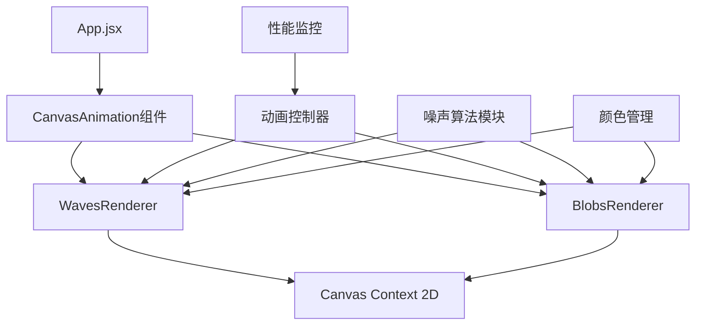
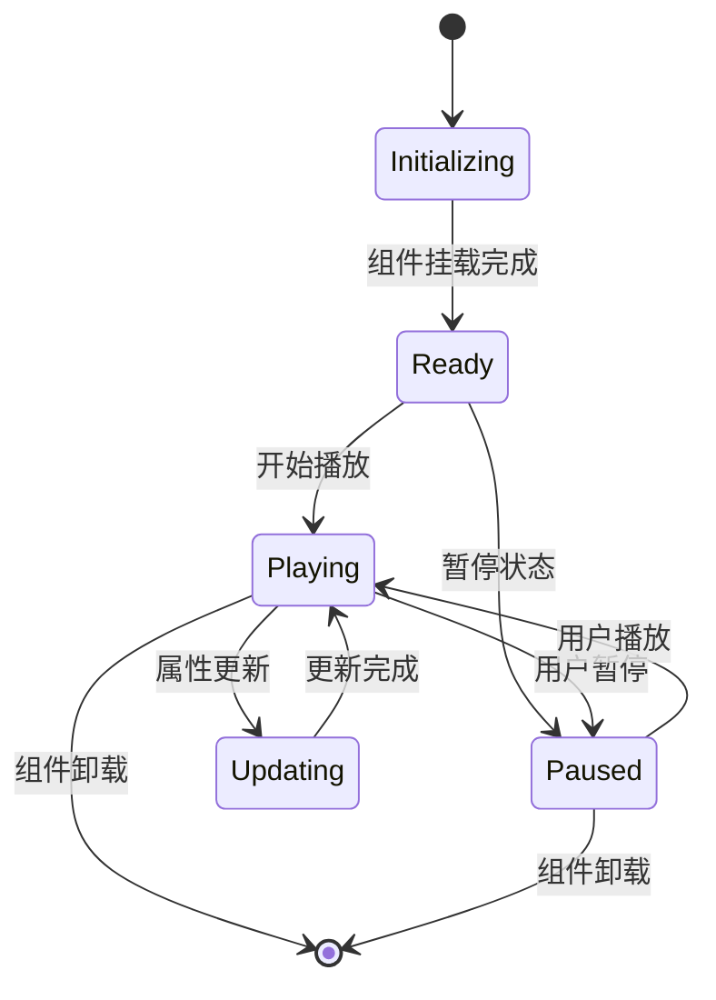
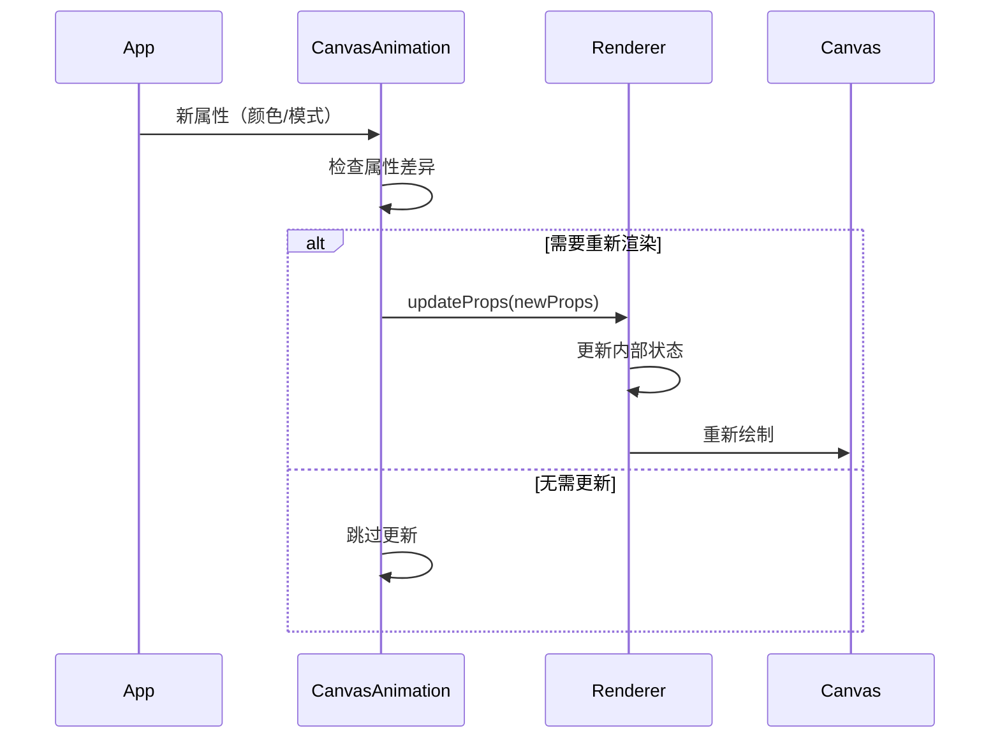

# p5.js 到 CSP 兼容动画库迁移设计

## 概述

几枝浏览器扩展目前因使用 p5.js 库导致内容安全策略（CSP）冲突，在浏览器中加载时报错：`Uncaught EvalError: Refused to evaluate a string as JavaScript because 'unsafe-eval' is not an allowed source of script in the following Content Security Policy directive: "script-src 'self'"`。

本设计文档旨在将项目从 p5.js 迁移到 CSP 兼容的原生 Canvas 2D 或其他符合浏览器扩展安全策略的动画库。

## 问题分析

### 当前技术栈
- **动画引擎**: p5.js + react-p5-wrapper
- **动画类型**: 
  - 波浪动画（waves.js）：5层叠加波浪效果，使用 Perlin 噪声算法
  - 色斑动画（blobs.js）：基于噪声的有机形状动画
- **集成方式**: ReactP5Wrapper 组件包装 p5.js 实例

### CSP 限制分析
浏览器扩展的 CSP 策略为：`"script-src 'self'; object-src 'self'"`，不允许：
- `eval()` 函数执行
- `Function()` 构造函数
- 动态代码执行
- 内联事件处理器

p5.js 内部使用了这些被禁止的特性，导致在严格的 CSP 环境下无法运行。

## 技术方案

### 方案选择

#### 方案一：原生 Canvas 2D API（推荐）
**优势：**
- 完全符合 CSP 要求
- 性能优异，无额外依赖
- 具备完整的绘图能力
- 代码体积最小

**劣势：**
- 需要手动管理动画循环
- API 相对底层，开发复杂度较高

#### 方案二：three.js（备选）
**优势：**
- 功能强大的 3D 图形库
- 良好的 WebGL 支持
- 丰富的文档和社区

**劣势：**
- 代码体积较大（>500KB）
- 功能过于复杂，项目仅需 2D 动画
- 可能存在 CSP 兼容性问题

#### 方案三：Konva.js（备选）
**优势：**
- 专门的 2D Canvas 库
- 良好的 React 集成
- 高性能渲染

**劣势：**
- 额外依赖（~200KB）
- 对于简单动画过于复杂

**最终选择：方案一（原生 Canvas 2D API）**

## 架构设计

### 新架构组件图



### 文件结构规划

```
src/
├── components/
│   └── CanvasAnimation/
│       ├── index.jsx              # 主组件
│       ├── renderers/
│       │   ├── WavesRenderer.js   # 波浪渲染器
│       │   └── BlobsRenderer.js   # 色斑渲染器
│       └── utils/
│           ├── noise.js           # 噪声算法
│           ├── animationLoop.js   # 动画循环控制
│           └── colorUtils.js      # 颜色工具
└── sketchs/ (待删除)
    ├── waves.js
    └── blobs.js
```

## 组件设计

### CanvasAnimation 主组件

```javascript
// src/components/CanvasAnimation/index.jsx
const CanvasAnimation = ({
  animationType,  // 'waves' | 'blobs'
  isPlaying,
  isDarkMode,
  waveColor
}) => {
  const canvasRef = useRef(null);
  const animationRef = useRef(null);
  const rendererRef = useRef(null);

  useEffect(() => {
    // 初始化渲染器和动画循环
  }, []);

  return (
    <canvas
      ref={canvasRef}
      style={{
        position: 'fixed',
        top: 0,
        left: 0,
        zIndex: -1,
        width: '100vw',
        height: '100vh'
      }}
    />
  );
};
```

### 渲染器接口设计

```javascript
// 渲染器基类接口
class BaseRenderer {
  constructor(canvas, options) {
    this.canvas = canvas;
    this.ctx = canvas.getContext('2d');
    this.options = options;
    this.animationId = null;
  }

  // 初始化方法
  init() {}

  // 渲染一帧
  render(timestamp) {}

  // 更新属性
  updateProps(newProps) {}

  // 销毁资源
  destroy() {}

  // 调整画布大小
  resize(width, height) {}
}
```

### 波浪动画实现

```javascript
// src/components/CanvasAnimation/renderers/WavesRenderer.js
class WavesRenderer extends BaseRenderer {
  constructor(canvas, options) {
    super(canvas, options);
    this.mountains = [];
    this.noise = new SimplexNoise();
  }

  init() {
    this.generateMountains();
    this.startAnimation();
  }

  generateMountains() {
    // 生成5层波浪山形
    for (let i = 0; i < 5; i++) {
      this.mountains.push({
        y: this.canvas.height - 50 * i,
        offset: Math.random() * 1000,
        alpha: 255 - 50 * i,
        time: 0
      });
    }
  }

  render(timestamp) {
    const { ctx, canvas } = this;
    
    // 清空画布
    ctx.clearRect(0, 0, canvas.width, canvas.height);
    
    // 绘制背景
    ctx.fillStyle = this.options.isDarkMode ? '#323232' : '#e6e6e6';
    ctx.fillRect(0, 0, canvas.width, canvas.height);
    
    // 绘制每层波浪
    this.mountains.forEach(mountain => {
      this.drawMountain(mountain, timestamp);
    });
  }

  drawMountain(mountain, timestamp) {
    const { ctx, canvas } = this;
    
    ctx.save();
    ctx.globalAlpha = mountain.alpha / 255;
    ctx.fillStyle = this.options.waveColor;
    
    ctx.beginPath();
    
    // 使用噪声生成波浪形状
    for (let x = 0; x <= canvas.width + 25; x += 25) {
      const noiseValue = this.noise.noise2D(
        x * 0.01 + mountain.offset,
        timestamp * 0.001 + mountain.offset
      );
      const y = mountain.y - noiseValue * 200;
      
      if (x === 0) {
        ctx.moveTo(x, y);
      } else {
        ctx.lineTo(x, y);
      }
    }
    
    // 闭合路径
    ctx.lineTo(canvas.width, canvas.height);
    ctx.lineTo(0, canvas.height);
    ctx.closePath();
    ctx.fill();
    
    ctx.restore();
  }
}
```

### 噪声算法实现

```javascript
// src/components/CanvasAnimation/utils/noise.js
class SimplexNoise {
  constructor() {
    this.grad3 = [
      [1,1,0], [-1,1,0], [1,-1,0], [-1,-1,0],
      [1,0,1], [-1,0,1], [1,0,-1], [-1,0,-1],
      [0,1,1], [0,-1,1], [0,1,-1], [0,-1,-1]
    ];
    this.p = [];
    this.perm = [];
    this.generatePermutation();
  }

  generatePermutation() {
    // 生成置换表
    for (let i = 0; i < 256; i++) {
      this.p[i] = Math.floor(Math.random() * 256);
    }
    
    for (let i = 0; i < 512; i++) {
      this.perm[i] = this.p[i & 255];
    }
  }

  noise2D(xin, yin) {
    // Simplex 噪声算法实现
    // 返回 [-1, 1] 范围内的值
  }
}
```

## 数据流设计

### 状态管理流程



### 属性更新流程



## 性能优化策略

### 渲染优化

1. **动态帧率控制**
   ```javascript
   const targetFPS = this.options.isPlaying ? 30 : 0;
   const frameInterval = 1000 / targetFPS;
   
   if (timestamp - this.lastFrameTime >= frameInterval) {
     this.render(timestamp);
     this.lastFrameTime = timestamp;
   }
   ```

2. **离屏渲染缓存**
   ```javascript
   // 对静态元素使用离屏画布缓存
   if (!this.backgroundCache) {
     this.backgroundCache = this.createBackgroundCache();
   }
   ```

3. **局部重绘优化**
   ```javascript
   // 只重绘变化的区域
   this.clearRect(dirtyRegion.x, dirtyRegion.y, dirtyRegion.width, dirtyRegion.height);
   ```

### 内存管理

1. **资源清理**
   ```javascript
   destroy() {
     if (this.animationId) {
       cancelAnimationFrame(this.animationId);
     }
     this.mountains = null;
     this.ctx = null;
   }
   ```

2. **事件监听器清理**
   ```javascript
   useEffect(() => {
     return () => {
       // 清理 resize 监听器
       window.removeEventListener('resize', handleResize);
     };
   }, []);
   ```

## 迁移计划

### 阶段一：基础架构搭建（第1-2天）
1. 创建 CanvasAnimation 组件框架
2. 实现基础渲染器类
3. 添加动画循环控制
4. 实现噪声算法模块

### 阶段二：波浪动画迁移（第3-4天）
1. 实现 WavesRenderer 类
2. 迁移波浪生成逻辑
3. 适配颜色和暗黑模式
4. 性能优化和测试

### 阶段三：色斑动画迁移（第5-6天）
1. 实现 BlobsRenderer 类
2. 迁移有机形状生成算法
3. 适配交互逻辑（鼠标点击）
4. 性能优化和测试

### 阶段四：集成和清理（第7天）
1. 更新 App.jsx 组件集成
2. 移除 p5.js 相关依赖
3. 更新构建配置
4. 完整测试和文档更新

## 风险评估

### 技术风险
| 风险 | 影响 | 概率 | 缓解措施 |
|------|------|------|----------|
| 噪声算法性能问题 | 中 | 低 | 使用Web Workers 或优化算法 |
| 浏览器兼容性 | 低 | 低 | Canvas 2D 支持良好 |
| 动画效果差异 | 中 | 中 | 精确复制原有视觉效果 |

### 业务风险
| 风险 | 影响 | 概率 | 缓解措施 |
|------|------|------|----------|
| 用户体验下降 | 高 | 低 | 充分测试，保持功能一致性 |
| 开发周期延长 | 中 | 中 | 分阶段开发，及时调整 |

## 测试策略

### 功能测试
1. **动画渲染测试**
   - 波浪动画层次正确性
   - 色斑动画形状生成
   - 颜色渐变效果

2. **交互测试**
   - 播放/暂停控制
   - 颜色模式切换
   - 鼠标点击响应（色斑模式）

3. **性能测试**
   - CPU 使用率监控
   - 内存泄漏检测
   - 帧率稳定性测试

### 兼容性测试
1. **浏览器测试**
   - Chrome 88+
   - Firefox 85+
   - Edge 88+

2. **设备测试**
   - 不同分辨率屏幕
   - 高分辨率（Retina）显示器
   - 低性能设备

### 单元测试

```javascript
// 噪声算法测试
describe('SimplexNoise', () => {
  test('应该生成[-1, 1]范围内的值', () => {
    const noise = new SimplexNoise();
    const value = noise.noise2D(0.5, 0.5);
    expect(value).toBeGreaterThanOrEqual(-1);
    expect(value).toBeLessThanOrEqual(1);
  });
});

// 渲染器测试
describe('WavesRenderer', () => {
  test('应该正确初始化山形数据', () => {
    const canvas = document.createElement('canvas');
    const renderer = new WavesRenderer(canvas, {});
    renderer.init();
    expect(renderer.mountains).toHaveLength(5);
  });
});
```

## 部署和回滚策略

### 部署步骤
1. 在开发环境验证新动画系统
2. 创建迁移分支进行集成测试
3. 更新 package.json 移除 p5.js 依赖
4. 更新构建脚本和 manifest 配置
5. 生产环境部署和验证

### 回滚策略
如果迁移后出现严重问题：
1. 恢复 p5.js 依赖
2. 临时修改 CSP 策略添加 'unsafe-eval'
3. 在开发环境修复问题后重新部署

### 渐进式部署
可考虑使用特性开关实现渐进式部署：
```javascript
const useNewAnimation = process.env.REACT_APP_NEW_ANIMATION === 'true';

return useNewAnimation ? 
  <CanvasAnimation {...props} /> : 
  <ReactP5Wrapper {...props} />;
```