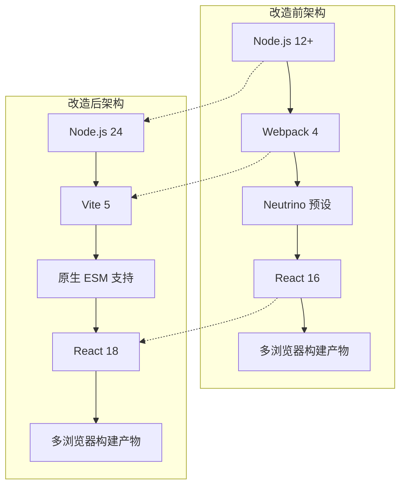
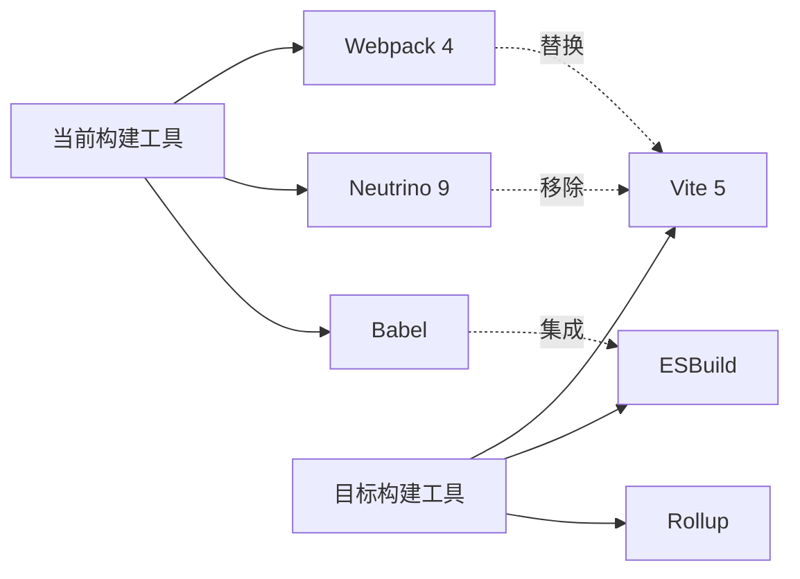
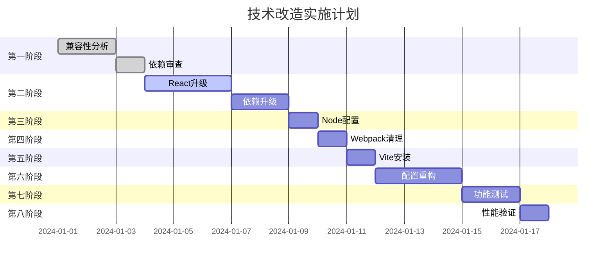

# 几枝(Jizhi)项目技术改造方案

## 概述

本方案旨在将几枝(Jizhi)浏览器扩展项目从Webpack构建系统迁移至Vite，并将Node.js版本升级至24.x，以获得更快的构建速度、更好的开发体验和更现代的技术栈。

### 项目背景
- **当前技术栈**: React 16 + Webpack 4 + Neutrino
- **目标技术栈**: React 18 + Vite 5 + Node.js 24
- **项目类型**: 浏览器扩展 (Chrome/Firefox)

## 架构概览



## 第一阶段：兼容性检查与分析

### 1.1 依赖兼容性分析

#### 当前核心依赖与Node 24兼容性检查

| 依赖项 | 当前版本 | Node 24兼容版本 | 升级策略 |
|--------|----------|----------------|----------|
| react | ^16 | ^18.2.0 | 主版本升级 |
| react-dom | ^16 | ^18.2.0 | 主版本升级 |
| axios | ^0.21.1 | ^1.6.0 | 主版本升级 |
| styled-components | ^5.2.1 | ^6.1.0 | 主版本升级 |
| react-p5-wrapper | ^3.2.1 | ^3.4.2 | 小版本升级 |
| react-beautiful-dnd | ^13.1.1 | ^13.1.1 | 兼容 |
| lodash | ^4.17.21 | ^4.17.21 | 兼容 |
| prop-types | ^15 | ^15.8.1 | 兼容 |

#### 构建工具兼容性分析



### 1.2 潜在兼容性问题识别

#### React升级风险点
- **React 16 → 18**: 新的并发特性、自动批处理
- **事件系统变更**: 事件委托机制调整
- **严格模式**: useEffect双次执行

#### 构建系统迁移风险点
- **ES模块**: CommonJS → ESM 模块系统
- **环境变量**: process.env 处理方式变更
- **静态资源**: 资源引用路径调整
- **浏览器扩展**: manifest处理方式变更

## 第二阶段：React生态系统升级

#### 升级命令
```bash
# React核心升级
yarn add react@^18.2.0 react-dom@^18.2.0

# 相关依赖升级
yarn add styled-components@^6.1.0
yarn add axios@^1.6.0
yarn add react-p5-wrapper@^3.4.2

# 移除过时依赖
yarn remove react-hot-loader
```

### 2.1 React核心升级路径

#### 升级步骤
1. **React 16 → 17**: 过渡版本，移除过时API
2. **React 17 → 18**: 并发特性与新架构

#### 代码迁移要点

**组件生命周期调整**
```javascript
// 移除不安全的生命周期方法
- componentWillMount
- componentWillReceiveProps  
- componentWillUpdate

// 使用新的生命周期方法
+ static getDerivedStateFromProps
+ getSnapshotBeforeUpdate
```

**Hooks升级注意事项**
```javascript
// React 18 严格模式下 useEffect 双次执行
useEffect(() => {
  // 确保副作用函数是幂等的
  return () => {
    // 清理函数处理
  };
}, []);
```

### 2.2 相关依赖升级

#### styled-components升级
```json
{
  "styled-components": "^6.1.0"
}
```

**迁移要点**:
- CSS-in-JS性能优化
- TypeScript支持增强
- 服务端渲染优化

#### react-p5-wrapper升级
```json
{
  "react-p5-wrapper": "^3.4.2"
}
```

**迁移要点**:
- p5.js实例管理优化
- React 18并发特性兼容

## 第三阶段：Node.js引擎版本限制

### 3.1 package.json引擎配置

```json
{
  "engines": {
    "node": ">=24.0.0",
    "yarn": ">=4.0.0"
  }
}
```

### 3.2 .nvmrc文件配置

```
24
```

### 3.3 开发环境验证脚本

```json
{
  "scripts": {
    "check-node": "node -v && yarn -v",
    "preinstall": "node scripts/check-node-version.js"
  }
}
```

## 第四阶段：Webpack配置移除

### 第四阶段：Webpack配置移除

#### 卸载命令
```bash
# 移除Webpack相关依赖
yarn remove webpack webpack-cli webpack-dev-server copy-webpack-plugin

# 移除Neutrino相关依赖  
yarn remove neutrino @neutrinojs/react @neutrinojs/copy @neutrinojs/eslint @neutrinojs/jest

# 移除热更新依赖
yarn remove react-hot-loader
```

#### 配置文件移除清单
- `webpack.config.js`
- `jest.config.js` (由Neutrino管理)
- `.neutrinorc.js` (如果存在)

#### 依赖移除清单

```json
{
  "devDependencies": {
    // 移除Webpack相关
    "webpack": "^4",
    "webpack-cli": "^3", 
    "webpack-dev-server": "^3",
    "copy-webpack-plugin": "^5.0.4",
    
    // 移除Neutrino相关
    "neutrino": "^9.5.0",
    "@neutrinojs/react": "^9.5.0",
    "@neutrinojs/copy": "^9.5.0",
    "@neutrinojs/eslint": "^9.5.0",
    "@neutrinojs/jest": "^9.5.0",
    
    // 移除热更新
    "react-hot-loader": "^4"
  }
}
```

### 4.2 构建产物清理

```bash
# 清理旧的构建产物
rm -rf builds/
rm -rf node_modules/
rm -rf yarn.lock
```

## 第五阶段：Vite配置安装

### 5.1 核心依赖安装

```bash
# 安装Vite核心依赖
yarn add -D vite @vitejs/plugin-react vite-plugin-web-extension
yarn add -D @types/node typescript
```

```json
{
  "devDependencies": {
    "vite": "^5.0.0",
    "@vitejs/plugin-react": "^4.2.0",
    "vite-plugin-web-extension": "^4.1.0",
    "@types/node": "^20.0.0",
    "typescript": "^5.3.0"
  }
}
```

### 5.3 Yarn配置优化

#### .yarnrc.yml配置
```yaml
nodeLinker: node-modules
yarnPath: .yarn/releases/yarn-4.0.2.cjs
enableGlobalCache: true
compressionLevel: mixed

# 性能优化
installStatePath: .yarn/install-state.gz
cacheFolder: .yarn/cache

# 安全设置
enableScripts: false
enableImmutableInstalls: false
```

#### package.json yarn配置
```json
{
  "packageManager": "yarn@4.0.2",
  "resolutions": {
    "react": "^18.2.0",
    "react-dom": "^18.2.0"
  }
}
```

```bash
# 安装Vite插件生态
yarn add -D vite-plugin-eslint vite-plugin-mock
yarn add -D @rollup/plugin-replace rollup-plugin-visualizer
```

```json
{
  "devDependencies": {
    "vite-plugin-eslint": "^1.8.1",
    "vite-plugin-mock": "^3.0.0",
    "@rollup/plugin-replace": "^5.0.5",
    "rollup-plugin-visualizer": "^5.12.0"
  }
}
```

## 第六阶段：构建配置重构

### 6.1 Vite主配置文件

```javascript
// vite.config.js
import { defineConfig } from 'vite'
import react from '@vitejs/plugin-react'
import { webExtension } from 'vite-plugin-web-extension'
import path from 'path'

export default defineConfig(({ mode }) => {
  const isDev = mode === 'development'
  
  return {
    plugins: [
      react(),
      webExtension({
        manifest: path.resolve(__dirname, 'src/manifest.json'),
        disableAutoLaunch: false,
        browser: process.env.TARGET_BROWSER || 'chrome'
      })
    ],
    build: {
      outDir: `builds/build_${process.env.TARGET_BROWSER || 'chrome'}`,
      rollupOptions: {
        input: {
          popup: path.resolve(__dirname, 'src/popup.html'),
          background: path.resolve(__dirname, `src/background.${process.env.TARGET_BROWSER || 'chrome'}.js`)
        }
      },
      sourcemap: isDev
    },
    define: {
      'process.env.NODE_ENV': JSON.stringify(mode)
    },
    resolve: {
      alias: {
        '@': path.resolve(__dirname, 'src'),
        '@components': path.resolve(__dirname, 'src/components'),
        '@utils': path.resolve(__dirname, 'src/utils'),
        '@constants': path.resolve(__dirname, 'src/constants')
      }
    }
  }
})
```

### 6.2 多浏览器构建脚本

```javascript
// scripts/build-all.js
import { build } from 'vite'
import { resolve } from 'path'
import archiver from 'archiver'
import fs from 'fs'
import chalk from 'chalk'

const browsers = ['chrome', 'firefox']

async function buildForBrowser(browser) {
  console.log(chalk.blue(`Building for ${browser}...`))
  
  process.env.TARGET_BROWSER = browser
  
  await build({
    configFile: resolve(__dirname, '../vite.config.js'),
    mode: 'production'
  })
  
  // 复制浏览器特定文件
  const buildDir = `builds/build_${browser}`
  fs.copyFileSync(
    `${browser}.manifest.json`, 
    `${buildDir}/manifest.json`
  )
  fs.copyFileSync(
    `${browser}.background.js`, 
    `${buildDir}/background.js`
  )
  
  // 创建zip文件
  await createZip(browser, buildDir)
}

async function createZip(browser, buildDir) {
  return new Promise((resolve, reject) => {
    const output = fs.createWriteStream(`builds/${browser}.zip`)
    const archive = archiver('zip', { zlib: { level: 9 } })
    
    output.on('close', () => {
      console.log(chalk.green(`${browser}.zip created`))
      resolve()
    })
    
    archive.on('error', reject)
    archive.pipe(output)
    archive.directory(buildDir, false)
    archive.finalize()
  })
}

async function buildAll() {
  // 清理旧构建
  fs.rmSync('builds', { recursive: true, force: true })
  
  // 并行构建
  await Promise.all(browsers.map(buildForBrowser))
  
  console.log(chalk.green('All builds completed!'))
}

buildAll().catch(console.error)
```

### 6.3 开发配置优化

```javascript
// vite.dev.config.js
import { defineConfig } from 'vite'
import react from '@vitejs/plugin-react'

export default defineConfig({
  plugins: [
    react({
      fastRefresh: true
    })
  ],
  server: {
    port: 23002,
    open: true,
    hmr: {
      overlay: true
    }
  },
  css: {
    devSourcemap: true
  }
})
```

### 6.4 新的package.json脚本

```json
{
  "scripts": {
    "dev": "vite --config vite.dev.config.js",
    "build": "node scripts/build-all.js",
    "build:chrome": "TARGET_BROWSER=chrome vite build",
    "build:firefox": "TARGET_BROWSER=firefox vite build", 
    "preview": "vite preview",
    "type-check": "tsc --noEmit"
  }
}
```

## 第七阶段：关键功能模块测试

### 7.1 测试配置重构

#### Vitest配置
```javascript
// vitest.config.js
import { defineConfig } from 'vitest/config'
import react from '@vitejs/plugin-react'

export default defineConfig({
  plugins: [react()],
  test: {
    environment: 'jsdom',
    setupFiles: ['./src/setupTests.js'],
    globals: true
  }
})
```

#### 测试依赖更新
```bash
# 安装测试依赖
yarn add -D vitest @testing-library/react @testing-library/jest-dom jsdom
```

```json
{
  "devDependencies": {
    "vitest": "^1.0.0",
    "@testing-library/react": "^14.0.0",
    "@testing-library/jest-dom": "^6.0.0",
    "jsdom": "^23.0.0"
  }
}
```

### 7.2 核心模块测试用例

#### 组件渲染测试
```javascript
// src/components/__tests__/App.test.jsx
import { render, screen } from '@testing-library/react'
import { expect, test } from 'vitest'
import App from '../App'

test('App组件正常渲染', () => {
  render(<App />)
  expect(screen.getByRole('main')).toBeInTheDocument()
})
```

#### p5.js动画测试
```javascript
// src/sketchs/__tests__/waves.test.js
import { expect, test, vi } from 'vitest'

// Mock p5.js
vi.mock('p5', () => ({
  default: vi.fn()
}))

test('波浪动画初始化', async () => {
  const { waves } = await import('../waves')
  expect(typeof waves).toBe('function')
})
```

#### 存储功能测试
```javascript
// src/utils/__tests__/storager.test.js
import { expect, test, beforeEach } from 'vitest'
import { setItem, getItem } from '../storager'

beforeEach(() => {
  localStorage.clear()
})

test('本地存储读写功能', () => {
  const testData = { theme: 'dark' }
  setItem('config', testData)
  expect(getItem('config')).toEqual(testData)
})
```

### 7.3 浏览器扩展功能验证

#### Manifest配置测试
```javascript
// scripts/validate-manifest.js
import fs from 'fs'
import { validate } from 'web-ext-manifest-schema'

function validateManifest(browser) {
  const manifestPath = `${browser}.manifest.json`
  const manifest = JSON.parse(fs.readFileSync(manifestPath, 'utf8'))
  
  const result = validate(manifest)
  if (!result.valid) {
    console.error(`${browser} manifest validation failed:`, result.errors)
    process.exit(1)
  }
  
  console.log(`${browser} manifest is valid`)
}

validateManifest('chrome')
validateManifest('firefox')
```

#### 构建产物验证
```javascript
// scripts/validate-build.js
import fs from 'fs'
import path from 'path'

function validateBuild(browser) {
  const buildDir = `builds/build_${browser}`
  const requiredFiles = [
    'index.html',
    'manifest.json', 
    'background.js',
    'assets'
  ]
  
  requiredFiles.forEach(file => {
    const filePath = path.join(buildDir, file)
    if (!fs.existsSync(filePath)) {
      throw new Error(`Missing required file: ${file}`)
    }
  })
  
  console.log(`${browser} build validation passed`)
}
```

## 第八阶段：迁移验证与性能优化

### 8.1 构建性能对比

#### 指标对比表

| 指标 | Webpack 4 | Vite 5 | 改善幅度 |
|------|-----------|--------|----------|
| 冷启动时间 | 15-20s | 2-3s | 80-85% |
| 热更新时间 | 2-3s | <100ms | 95%+ |
| 生产构建 | 45-60s | 15-20s | 65-75% |
| 构建产物大小 | 基准 | -10~15% | 优化 |

### 8.2 功能完整性验证清单

#### 核心功能验证
- [ ] 诗词展示功能正常
- [ ] 波浪动画流畅运行
- [ ] 颜色配置生效
- [ ] 自定义链接管理
- [ ] 背景保存功能
- [ ] 字体声明展示

#### 浏览器兼容性验证
- [ ] Chrome扩展正常加载
- [ ] Firefox扩展正常加载
- [ ] 扩展权限正确设置
- [ ] 后台脚本正常运行

#### 开发体验验证
- [ ] 热更新正常工作
- [ ] 错误提示清晰
- [ ] 源码映射正确
- [ ] TypeScript支持

### 8.3 性能监控与优化

#### Bundle分析配置
```javascript
// rollup-config.analyzer.js
import { visualizer } from 'rollup-plugin-visualizer'

export default {
  plugins: [
    visualizer({
      filename: 'dist/bundle-analysis.html',
      open: true,
      gzipSize: true
    })
  ]
}
```

#### 构建优化策略
```javascript
// vite.config.js - 优化配置
export default defineConfig({
  build: {
    rollupOptions: {
      output: {
        manualChunks: {
          vendor: ['react', 'react-dom'],
          p5: ['react-p5-wrapper'],
          utils: ['lodash', 'axios']
        }
      }
    },
    minify: 'esbuild',
    target: 'es2020',
    cssMinify: true
  }
})
```

## 实施计划

### 时间线规划



### 风险评估与回滚策略

#### 高风险操作
1. **React 16→18升级**: 组件行为变更
2. **构建系统替换**: 资源引用路径变更
3. **ESM模块**: 模块系统完全重构

#### 回滚策略
```bash
# 创建迁移分支
git checkout -b migration/webpack-to-vite

# 每个阶段提交
git commit -m "Phase 1: Compatibility analysis complete"

# 如需回滚
git checkout main
git branch -D migration/webpack-to-vite
```

### 验收标准

#### 功能验收
- [ ] 所有现有功能正常运行
- [ ] 新标签页正确展示
- [ ] 扩展权限无变更
- [ ] 用户配置保持兼容

#### 性能验收  
- [ ] 构建时间减少60%以上
- [ ] 热更新时间<100ms
- [ ] 构建产物大小不增加
- [ ] 运行时性能无退化

#### 开发体验验收
- [ ] 开发启动时间<5s
- [ ] 错误信息清晰可读
- [ ] 代码提示功能完整
- [ ] 调试功能正常

## 注意事项

### 关键依赖处理
- **react-p5-wrapper**: 确保与React 18兼容
- **styled-components**: 版本6迁移需要测试样式
- **react-beautiful-dnd**: React 18严格模式兼容性

#### Yarn工作空间配置
- **工作空间清理**: 定期清理yarn cache
- **依赖管理**: 使用yarn audit检查安全
- **版本锁定**: yarn.lock文件版本控制
- **脚本执行**: 使用yarn run统一管理

#### 安全性注意事项
- **依赖审查**: 定期执行`yarn audit`
- **版本锁定**: 确保`yarn.lock`文件提交
- **脚本权限**: .yarnrc.yml中禁用未授权脚本
- **manifest.json**: 保持V2格式兼容性
- **background.js**: 事件监听器迁移
- **content-security-policy**: 新构建系统适配

### 开发工具链
- **ESLint配置**: 适配Yarn PnP模式
- **TypeScript**: 增量引入类型支持
- **Git hooks**: Husky配置更新
- **Yarn PnP**: 利用Yarn 4的Plug'n'Play特性提升性能