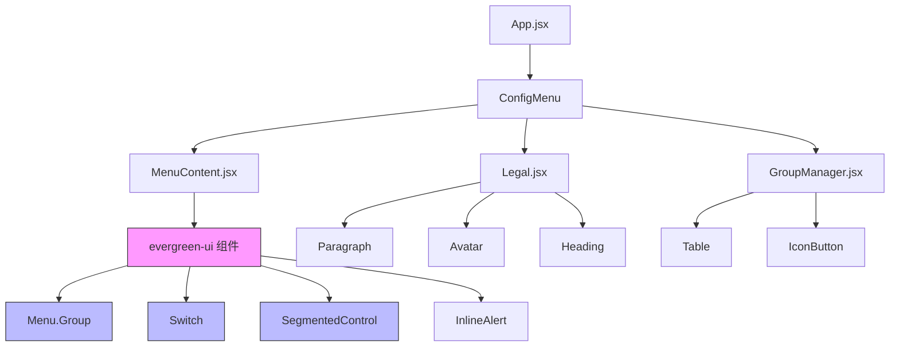
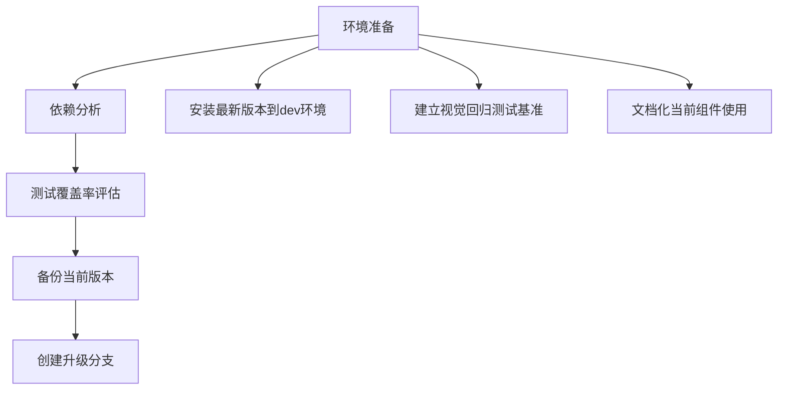
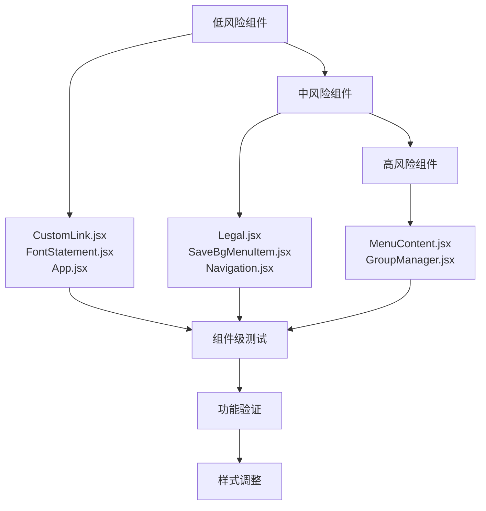
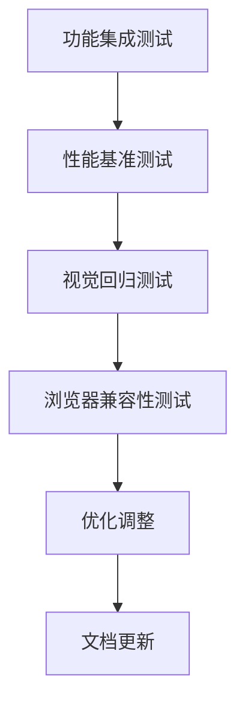
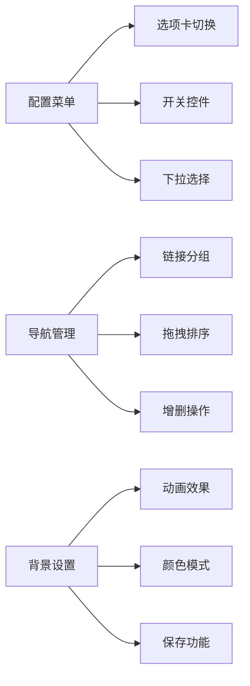
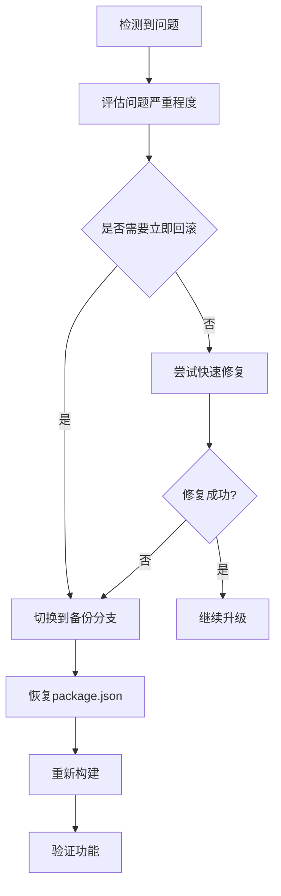
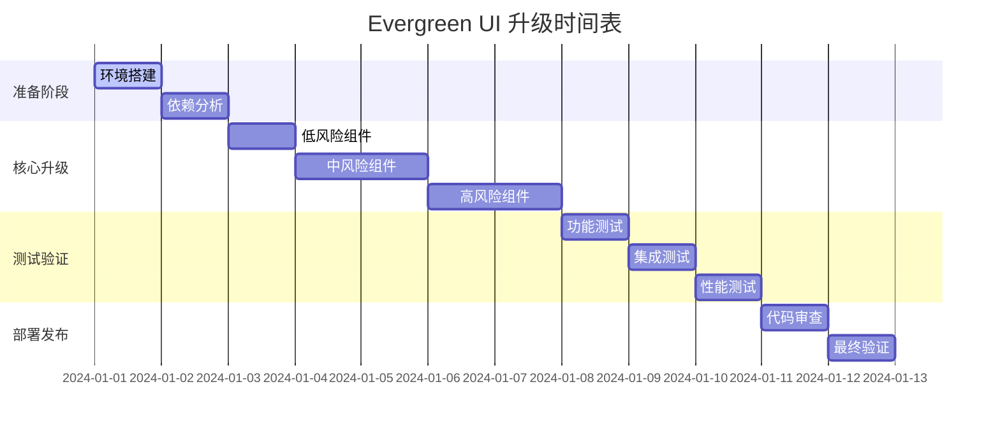

# 几枝项目 Evergreen UI 升级设计

## 1. 概述

### 升级目标
将几枝项目中的 `evergreen-ui` 从当前版本 `^4.19.1` 升级到最新版本 `v7.x`，以获得更好的性能、现代化的API和修复已知问题。

### 当前状态
- **当前版本**: evergreen-ui@4.19.1 (实际安装版本: 4.29.1)
- **目标版本**: evergreen-ui@7.x (最新稳定版)
- **主要动机**: 解决React 18兼容性问题、获得现代化组件、提升性能

### 项目影响范围
根据代码分析，项目中使用了以下evergreen-ui组件：
- **高频使用**: Menu, Switch, SegmentedControl, InlineAlert, Text
- **中频使用**: Link, Spinner, Dialog, TextInput, Pane
- **低频使用**: Table, IconButton, TextInputField, Paragraph, Avatar, Heading

## 2. 技术架构分析

### 当前使用模式



### 依赖关系映射

| 组件文件 | 使用的 evergreen-ui 组件 | 影响等级 |
|----------|-------------------------|----------|
| MenuContent.jsx | Menu, Switch, SegmentedControl, Spinner, Text, InlineAlert | 高 |
| Legal.jsx | Paragraph, Avatar, Heading, Pane | 中 |
| GroupManager.jsx | Pane, Table, TextInputField, IconButton系列 | 高 |
| CustomLink.jsx | Link | 低 |
| FontStatement.jsx | InlineAlert | 低 |
| SaveBgMenuItem.jsx | Menu.Item | 中 |
| Navigation.jsx | Dialog, TextInput, Pane | 中 |
| App.jsx | InlineAlert | 低 |

## 3. 升级兼容性分析

### 破坏性变更预估

#### 主要API变更
根据evergreen-ui v7升级指南分析：

1. **主题系统重构**
   - 从CSS-in-JS迁移到基于CSS变量的主题系统
   - 颜色tokens和spacing系统调整
   
2. **组件API标准化**
   - Props命名规范统一
   - 移除过时的defaultProps模式
   - 改进TypeScript支持

3. **图标系统更新**
   - 图标组件API变更
   - IconButton组件props调整

#### 现有问题分析
项目已存在部分evergreen-ui兼容性问题：
- 项目已有自定义组件替代方案（CustomPane, CustomTablist, CustomSidebarTab）
- 存在defaultProps警告（项目历史任务记录显示）

### 风险评估矩阵

| 风险类型 | 概率 | 影响 | 缓解措施 |
|----------|------|------|----------|
| 组件API破坏性变更 | 高 | 高 | 渐进式升级，组件级测试 |
| 样式系统变更 | 中 | 中 | 主题配置迁移，视觉回归测试 |
| TypeScript类型冲突 | 中 | 低 | 类型定义更新 |
| 打包体积增加 | 低 | 低 | Tree-shaking优化 |

## 4. 实施策略

### 分阶段升级方案

#### 阶段1: 准备阶段（1-2天）


**具体任务**:
- 创建专用升级分支 `feature/upgrade-evergreen-ui-v7`
- 安装evergreen-ui@7.x到开发环境
- 运行现有测试套件，记录基准结果
- 截取关键UI界面作为视觉参考

#### 阶段2: 核心组件升级（3-5天）


**优先级排序**:
1. **低风险组件** (1天)
   - CustomLink.jsx: 简单Link组件升级
   - FontStatement.jsx: InlineAlert组件升级
   - App.jsx: 单个InlineAlert使用

2. **中风险组件** (2天)
   - Legal.jsx: Paragraph, Avatar, Heading组件群
   - SaveBgMenuItem.jsx: Menu.Item API变更
   - Navigation.jsx: Dialog, TextInput组件

3. **高风险组件** (2天)
   - MenuContent.jsx: 核心配置界面，组件最密集
   - GroupManager.jsx: 复杂表格和图标按钮组合

#### 阶段3: 集成测试与优化（2-3天）


### 技术实施细节

#### 组件迁移模板
```jsx
// 升级前
import { Menu, Switch } from 'evergreen-ui';

// 升级后 - 检查API变更
import { Menu, Switch } from 'evergreen-ui';

// 如果有破坏性变更，创建适配组件
const CompatMenu = (props) => {
  // 处理API变更逻辑
  const adaptedProps = adaptPropsForV7(props);
  return <Menu {...adaptedProps} />;
};
```

#### 样式迁移策略
```jsx
// 主题配置迁移
const theme = {
  // v4 主题配置
  colors: {
    intent: {
      success: '#47B881',
      // ...
    }
  }
};

// v7 主题配置 (基于CSS变量)
const themeV7 = {
  // 新的主题结构
  tokens: {
    colors: {
      green: {
        500: '#47B881',
        // ...
      }
    }
  }
};
```

## 5. 测试策略

### 测试范围定义

#### 功能测试


#### 视觉回归测试
- 关键界面截图对比
- 字体渲染验证
- 动画效果一致性
- 响应式布局检查

#### 性能测试
- 组件加载时间
- 内存使用情况
- 包体积变化
- 渲染性能对比

### 测试工具配置
```javascript
// vitest.config.js 扩展
export default defineConfig({
  test: {
    // 现有配置
    environment: 'jsdom',
    setupFiles: ['./src/setupTests.js'],
    
    // 升级测试扩展
    coverage: {
      include: ['src/components/ConfigMenu/**'],
      exclude: ['**/*.test.{js,jsx}']
    }
  }
});
```

## 6. 回滚计划

### 回滚触发条件
- 关键功能异常且24小时内无法修复
- 性能下降超过20%
- 视觉效果严重偏差且影响用户体验
- 浏览器兼容性问题

### 回滚执行流程


### 数据备份策略
- Git分支备份: `backup/pre-evergreen-upgrade`
- 配置文件快照: `package.json`, `yarn.lock`
- 关键组件代码备份

## 7. 风险评估与缓解

### 技术风险

| 风险项 | 影响程度 | 发生概率 | 缓解措施 |
|--------|----------|----------|----------|
| API破坏性变更导致组件无法工作 | 高 | 中 | 建立适配层，渐进式迁移 |
| 主题系统变更影响视觉效果 | 中 | 高 | 视觉回归测试，样式适配 |
| 新版本性能问题 | 中 | 低 | 性能基准测试，打包优化 |
| TypeScript类型冲突 | 低 | 中 | 类型定义更新，兼容性处理 |

### 业务风险

| 风险项 | 影响程度 | 发生概率 | 缓解措施 |
|--------|----------|----------|----------|
| 用户界面功能异常 | 高 | 低 | 完整的功能测试覆盖 |
| 扩展安装/更新失败 | 高 | 低 | 多浏览器测试验证 |
| 配置迁移丢失 | 中 | 极低 | 本地存储不受影响 |

## 8. 实施时间表

### 详细任务计划



### 里程碑定义

- **M1**: 升级环境准备完成，基准测试建立
- **M2**: 所有组件升级完成，无编译错误
- **M3**: 功能测试通过，视觉效果确认
- **M4**: 性能测试达标，准备发布

## 9. 成功标准

### 功能标准
- ✅ 所有现有功能正常工作
- ✅ 配置菜单交互无异常
- ✅ 导航管理功能完整
- ✅ 样式显示与升级前一致

### 性能标准
- ✅ 组件渲染时间不超过当前版本的110%
- ✅ 打包体积增幅控制在15%以内
- ✅ 内存使用无明显增长

### 质量标准
- ✅ 零运行时错误
- ✅ TypeScript类型检查通过
- ✅ ESLint检查无新增警告
- ✅ 所有自动化测试通过

## 10. 后续维护计划

### 监控策略
- 建立组件使用监控
- 性能指标持续跟踪
- 用户反馈收集机制

### 优化机会
- 利用v7新特性优化现有组件
- 移除已废弃的自定义组件适配
- 探索性能优化空间

### 版本维护
- 建立evergreen-ui版本更新策略
- 定期安全更新检查
- 兼容性持续验证